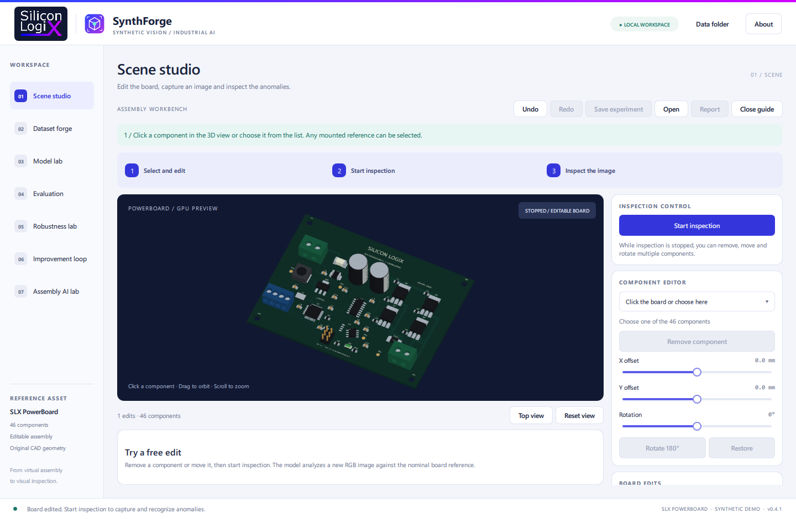

<!-- Silicon LogiX / SLX SynthForge · Copyright (c) 2026 Marco Pezzullo. -->
# SLX SynthForge

A local desktop demonstration of synthetic industrial inspection by **Silicon LogiX**.
Edit a 3D assembly, acquire an image, inspect the captured pixels and compare AI
versions using a separate frozen test. No camera or industrial hardware is required.



## Try the Windows application

Open `slx-synthforge.exe` in the portable release. In **Scene studio**, select a
component, remove it or change its position, then click **Start inspection**.
Click a result to see the captured detail and its CAD reference. Click **Stop**
to edit again. **Guided trial**, Undo/Redo and portable experiment reports explain
each step. The included model inspects all 46 mounted component references.

**Assembly AI lab** includes a completed comparison and an optional training
workflow. **Dataset forge**, **Robustness lab** and **Improvement loop** cover
five C1/U4 scenarios, including reversed polarity and a solder bridge.
Rendering and inference need no Python. Training requires a separately installed
Python with the dependencies in `tools/requirements.txt`.

See the [quick start](docs/quick-start.md), [presentation walkthrough](docs/demo-v04.md)
and [verified results](docs/validation.md).

## Build the demonstration

The included binary SDK requires **Windows x64, Qt 6.12.0 and MinGW GCC 13.1.0**.
Install CMake 3.24 or newer, Ninja and that matching Qt kit, then run:

```powershell
./scripts/build-windows.ps1
```

The executable is written to `build/windows-mingw`. Kit locations can be passed
as `-QtRoot` and `-ToolchainBin`. The build runs the available automated checks.
For training, install Python and run:

```powershell
python -m pip install -r tools/requirements.txt
```

The source demonstration uses `SiliconLogiX.SynthForge.Core.dll` (ABI 4).
The proprietary implementation is supplied as a binary; the public API uses
`SiliconLogiX::SynthForge`. See [architecture](docs/architecture.md) and [SDK](docs/sdk.md).

## Scope and license

PowerBoard is an original visual sample with no electrical validation. The
editable-board model recognizes nominal appearance, absence and changed
position/appearance in a repeatable acquisition. The five-scenario model covers
C1/U4 defects. Hidden or visually symmetric changes and unsupported acquisitions
require verification. Scores are uncalibrated. Synthetic results do not establish
performance on real factory photographs.

Copyright © 2026 Marco Pezzullo · Silicon LogiX. The [Evaluation License](LICENSE)
permits business evaluation and private evaluation changes. It is a source
available license, not an OSI open source license. Commercial integration and
distribution of modified versions require written permission. Brand names identify
the origin; they do not prevent reuse or reverse engineering technically.

Qt is linked dynamically. The portable release includes license texts and
corresponding runtime sources with replacement instructions. See
[third-party sources](THIRD_PARTY_SOURCE.md).
