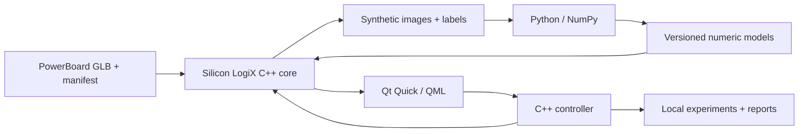

<!-- Silicon LogiX / SLX SynthForge · Copyright (c) 2026 Marco Pezzullo. -->
# Architecture

Qt Quick/QML implements the desktop interface. C++ coordinates asynchronous
rendering, data generation and inspection. Optional Python/NumPy training produces
versioned numeric JSON models without executable model payloads.

The API boundary is `SiliconLogiX.SynthForge.Core.dll`, ABI 4. Its SDK declares
`SiliconLogiX::SynthForge::Engine` and `Model`. The renderer, visual analysis,
acquisition checks and C++ inference are supplied as a proprietary binary.
`SiliconLogiX_SynthForge_CoreIdentity` identifies the product, vendor and ABI.

The OpenGL preview changes the camera using retained geometry. Recognition
acquires a separate repeatable image. A software preview supports systems without
OpenGL 3.3. Work runs outside the UI thread; cancellation leaves partial outputs
marked incomplete and keeps completed models intact.

Two models have distinct purposes: the five-scenario C1/U4 laboratory, including
a solder bridge, and the 46-reference editable assembly inspector. The inspector
receives RGB, an acquisition profile and a numeric model. Applied edits are
recorded afterwards as audit metadata; they are not recognition inputs.

Experiments retain images, results, edits and model identity. Loading checks
file hashes, asset identity and recomputed results before changing the live board.
Historical explanatory labels are regenerated in English. Hashes are not signatures.

Improvement freezes its baseline and independent test before collecting cases.
Additional examples affect training/validation only. Both versions use the same
benchmark and threshold; activation is explicit. Results expose review coverage
and accepted errors as well as raw accuracy.
